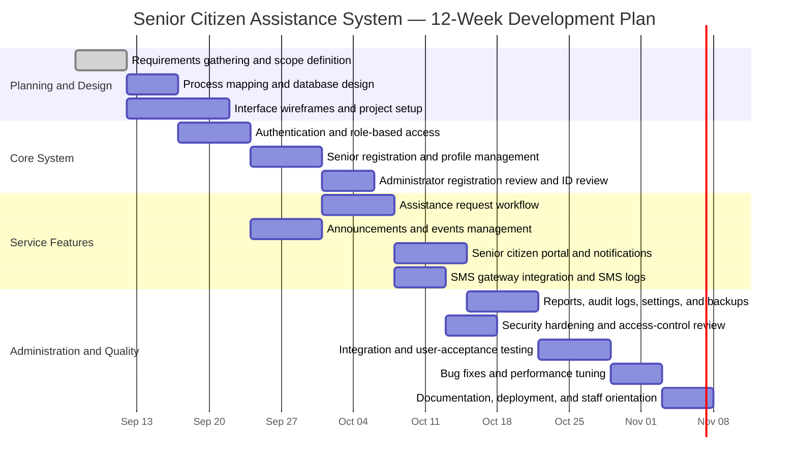

# Development Gantt Chart

This schedule covers the development of the **Senior Citizen Assistance System for Barangay Services**. It assumes a 12-week implementation period, with testing and documentation running alongside feature development.

| Week | Main deliverables |
| --- | --- |
| 1 | Requirements, user roles, scope, and development environment |
| 2 | Database schema, workflow design, and interface wireframes |
| 3 | Login, registration foundation, sessions, and role authorization |
| 4 | Senior profile management and administrator registration approval |
| 5 | Assistance-request submission, processing, scheduling, and status tracking |
| 6 | Announcements, events, dashboards, and senior-facing views |
| 7 | Notifications, SMS gateway integration, and delivery logs |
| 8 | Reports, user management, audit logs, settings, and backup workflow |
| 9 | Security review: CSRF, validation, authorization, uploads, and error handling |
| 10 | End-to-end integration testing and user-acceptance testing |
| 11 | Defect resolution, usability improvements, and performance checks |
| 12 | User guide, technical documentation, deployment, and staff orientation |

## Milestones

1. **End of Week 2:** Approved database design and user-interface plan.
2. **End of Week 4:** Working registration, login, role access, and senior records.
3. **End of Week 7:** Core barangay services and SMS notification workflow complete.
4. **End of Week 9:** Administrative tools and security review complete.
5. **End of Week 12:** Tested system deployed with documentation and trained users.
